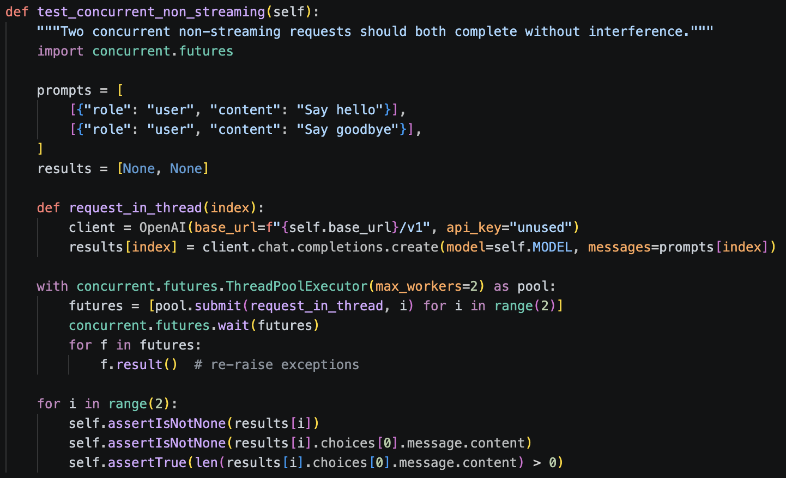

# Explorando Práticas de Teste

Neste exercício, vamos explorar práticas de teste em sistemas reais utilizando a ferramenta [TestMiner](https://andrehora.github.io/testminer).

O TestMiner permite visualizar e analisar testes de software em repositórios do GitHub, fornecendo dados sobre como os projetos organizam seus testes, como eles evoluem entre versões e quais bibliotecas de teste são utilizadas.
Explore a ferramenta antes de começar para se familiarizar com seu funcionamento.

Mais detalhes no GitHub da ferramenta: https://github.com/andrehora/testminer.

---

## Passo 1: Selecionar um repositório

Escolha um repositório real que possua testes de software.
Abaixo estão alguns links para ajudá-lo a encontrar projetos interessantes:

- Python: https://github.com/topics/python?l=python
- JavaScript: https://github.com/topics/javascript?l=javascript
- TypeScript: https://github.com/topics/typescript?l=typescript
- Java: https://github.com/topics/java?l=java

- Tópicos: [ai](https://andrehora.github.io/testminer/#topic:ai), [llm](https://andrehora.github.io/testminer/#topic:llm), [api](https://andrehora.github.io/testminer/#topic:api), [nodejs](https://andrehora.github.io/testminer/#topic:nodejs), [android](https://andrehora.github.io/testminer/#topic:android)

- Por organização: [Google](https://andrehora.github.io/testminer/#google), [Microsoft](https://andrehora.github.io/testminer/#microsoft), [Apple](https://andrehora.github.io/testminer/#apple), [Facebook](https://andrehora.github.io/testminer/#facebook), [Netflix](https://andrehora.github.io/testminer/#netflix), 
[GitHub](https://andrehora.github.io/testminer/#github), [Apache](https://andrehora.github.io/testminer/#apache), [HuggingFace](https://andrehora.github.io/testminer/#huggingface)

## Passo 2: Explorar o repositório selecionado

Busque o repositório escolhido no [TestMiner](https://andrehora.github.io/testminer) e analise os dados de teste gerados pela ferramenta.

## Passo 3: Explicar uma prática de teste

Escolha uma prática ou dado de teste relevante e explique com suas próprias palavras.

---

## Instruções de entrega

1. Faça um `fork` deste repositório (saiba mais sobre forks [aqui](https://docs.github.com/pt/pull-requests/collaborating-with-pull-requests/working-with-forks/fork-a-repo)).
2. Responda às questões abaixo diretamente neste arquivo `README.md` do seu fork. Pode adicionar imagens para enriquecer sua explicação.
3. No Moodle, submeta apenas a URL do seu fork.

---

## Respostas

Repositório: `https://github.com/huggingface/transformers`

URL TestMiner: `https://andrehora.github.io/testminer/#huggingface/transformers`

Explicação:

Acredito que um dos testes interessantes desse repositório se encontra dentro da pasta `tests/cli`, no script de nome `test_serve.py`. Achei muito interessante a forma de teste de sistemas rodando em paralelo.

Primeiramente, no uso do transformers no CLI, o comando `transformers serve` serve para subir um servidor local de inferência HTTP. Ele transforma o seu modelo de Inteligência Artificial local em uma API REST ativa, permitindo que você ou outras aplicações façam requisições para gerar texto sem precisar escrever um script em Python para gerenciar o servidor.

Destaco o teste da função `test_concurrent_non_streaming`, que dispara duas requisições ao mesmo tempo e verifica, segundo sua descrição, que: "Two concurrent non-streaming requests should both complete without interference".

Ela inicialmente prepara dois pedidos, ambos com o papel `"user"`, mas com conteúdos diferentes: "Say hello" e "Say goodbye". Prepara também uma lista `results`, inicialmente com dois valores `None`, que receberá as respostas do modelo: a resposta ao primeiro pedido na posição 0 e a resposta ao segundo na posição 1.

Logo em seguida, ela dispara as threads em paralelo usando `concurrent.futures.ThreadPoolExecutor(max_workers=2)` dentro de um bloco `with`. Cada thread cria seu próprio cliente OpenAI apontando para o servidor local e envia um dos pedidos, guardando a resposta do modelo na posição correspondente de `results`.

Em seguida, o teste espera as duas threads terminarem e chama `.result()` em cada uma, para que qualquer erro ocorrido dentro da thread faça o teste falhar. Por fim, verifica que as duas respostas existem e não estão vazias. O objetivo é garantir que o servidor atenda dois clientes simultâneos sem que um atrapalhe o outro.